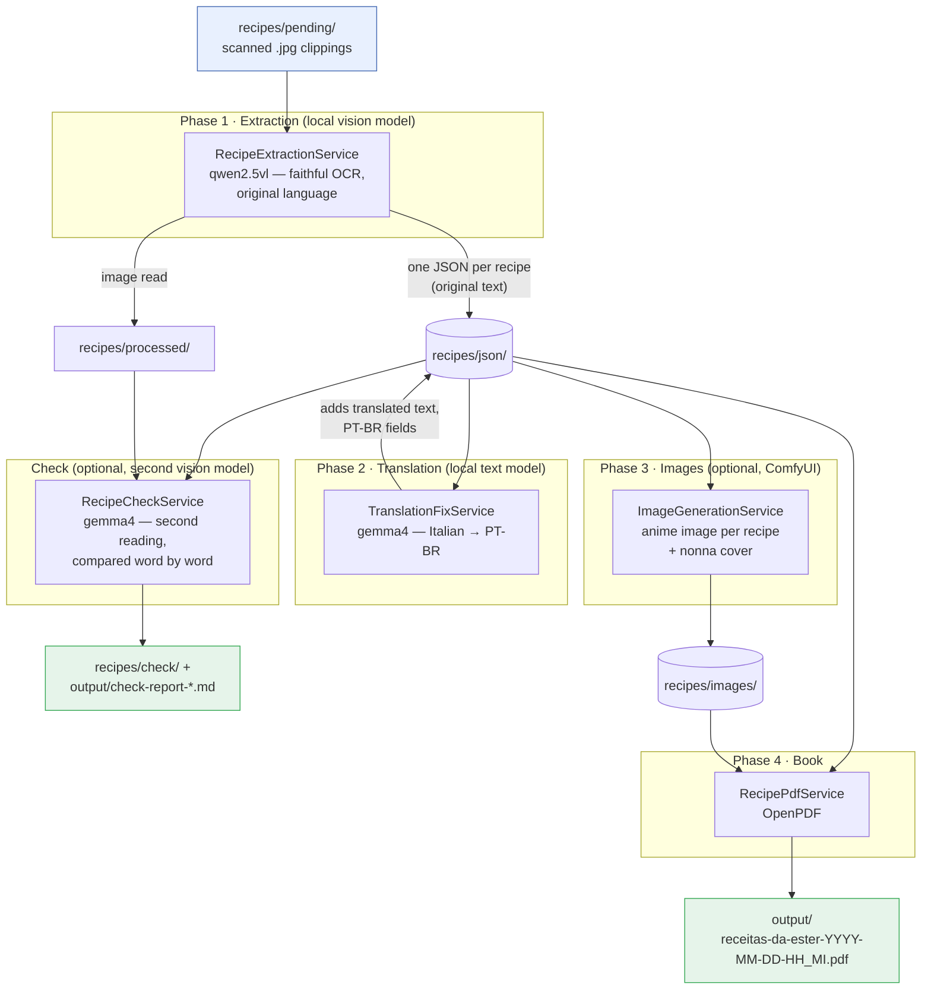

# Development

How the app is built and how to change it. To just make the book, see the [README](README.md),
which also describes the folders and files it generates. The requirements the app implements are
in [`AGENTS.md`](AGENTS.md).

Built on **Spring Boot 4.1.2**, **Spring AI 2.0.2** and **OpenPDF** (Java 21+, tested on JDK 25).

## Build and test

```bash
mvn test                # run the tests
mvn clean package       # build target/ester-recipes-1.0.0.jar (clean deletes the old jar)
```

`run-all.sh` only builds the jar if there isn't one, so run `mvn package` after changing the code.

To run the app without the script, and without its record in `runs/`:

```bash
mvn spring-boot:run -Dspring-boot.run.arguments="--ester.translation.enabled=true --ester.check.enabled=true"
java -jar target/ester-recipes-1.0.0.jar --ester.translation.enabled=true --ester.check.enabled=true
```

## Architecture

The pipeline runs in phases so the 8 GB GPU only ever hosts one model at a time:



1. **Extraction:** `RecipePipeline` scans `recipes/pending/`, skipping anything identical already in
   `recipes/processed/`. Each image is scaled down and goes to the Ollama **vision model**, which
   transcribes it **faithfully in the original language**. A JSON schema is passed as Ollama's
   `format`, so output is grammar-constrained to `{ "recipes": [ ... ] }`. One JSON per recipe is
   written, then the image is moved. A recipe with no title fails the image, because the book would
   leave it out.
2. **Check (opt-in, after translation):** `RecipeCheckService` reads each processed scan with a second model.
   `ReadingComparison` compares that text with the `original` text word by word, ignoring case,
   accents, punctuation, list numbers and how the recipes were split. A page needs review if numbers
   differ, one reading has a passage of 3 or more words the other lacks, or under 90% of the words
   match. The check model must differ from the main one, because a model at temperature 0 would
   agree with itself.
3. **Translation (opt-in):** `TranslationFixService` sends every non-Portuguese recipe to a text model.
   Each recipe keeps both its `original` (verbatim) and `translated` text. This phase is idempotent.
4. **Images (opt-in):** `ImageGenerationService` asks a local **ComfyUI** server for one small anime
   image per recipe (food only, no people), plus a bigger cover of an Italian *nonna* surrounded by
   every food category. Images are downscaled and embedded as compact JPEGs, so a 400-recipe book is
   only ~6 MB.
5. **Book:** `RecipePdfService` builds the cookbook from all the JSON: two recipes per page with their
   images, a clickable index, a per-category summary, sorted by category.

Failures are logged and retried in up to 5 rounds. If an image still can't be read, the run stops with
an error before building the PDF. The exception is a scan the model still answers has no recipe in the
last round: it moves to `recipes/no-recipe/` and the report lists it.

`BookSelection` decides what goes in the book. Same-name recipes sharing at least 60% of the meaningful
words of the smaller one count as one, and the most complete reading is used; the others stay in, numbered.
The limit comes from little data: 98% for two readings of one clipping, at most 38% between different
recipes on a page.

## Configuration

Defaults are in `src/main/resources/application.yml`. Override any of them with `--key=value`, which
`run-all.sh` passes on to the app.

| Key | Default | Meaning |
|-----|---------|---------|
| `spring.ai.ollama.chat.model` | `qwen2.5vl:7b` | vision / OCR model (`MAIN_MODEL` in `run-all.sh`) |
| `spring.ai.ollama.chat.num-ctx` / `num-predict` | `8192` / `8192` | context + output caps (keep the model on-GPU, bound runaway) |
| `ester.input-dir` | `./recipes/pending` | folder scanned for images |
| `ester.processed-dir` | `./recipes/processed` | folder read images move to |
| `ester.no-recipe-dir` | `./recipes/no-recipe` | folder for scans with no recipe found |
| `ester.json-dir` | `./recipes/json` | folder of the recipe JSON files |
| `ester.output-dir` | `./output` | folder of the PDF, reports and logs |
| `ester.concurrency` | `1` | images processed in parallel (virtual threads) |
| `ester.max-image-side` | `1600` | longest side of the image sent to the model, in pixels; the file on disk is unchanged (`0` sends the original) |
| `ester.check.enabled` / `.model` / `.dir` | `false` / `gemma4:latest` / `./recipes/check` | the check phase (`CHECK_MODEL` in `run-all.sh`) |
| `ester.translation.enabled` / `.model` | `false` / `gemma4:latest` | the translation phase |
| `ester.images.enabled` / `.base-url` / `.checkpoint` | `false` / `localhost:8188` / … | the ComfyUI image phase |
| `ester.images.dir` | `./recipes/images` | folder of the generated images |
| `ester.images.seed-offset` | `0` | added to every image seed; change it to redraw deleted images differently |
| `ester.reviewed.enabled` / `.dir` | `false` / `./reviewed` | build the book only from the hand-reviewed JSON in git; reads no scan and changes no file there |
| `ester.pdf-title` | `Receitas da Ester` | cover title |

`run-all.sh` expects the default folders when it counts scans and copies the report.

## Project layout

`run-all.sh` runs everything and records the run. The code is under `src/main/java/com/ester/recipes/`:

```
model/Recipe.java                    one recipe (incl. original + translated text)
model/StoredRecipe.java              recipe + its JSON file stem (links to its image)
config/EsterProperties.java          @ConfigurationProperties("ester")
service/RecipePipeline.java          orchestrates the phases
service/RecipeExtractionService.java vision OCR, faithful, schema-constrained
service/RecipeCheckService.java      second reading of each scan + review report
service/ReadingComparison.java       word-by-word comparison of two readings
service/RecipeText.java              AGENTS.md text rules (capitals, repeats, list numbers)
service/TranslationFixService.java   gemma4 translation phase (idempotent)
service/CategoryNormalizer.java      canonical PT-BR categories (no "Outras")
service/ImageGenerationService.java  ComfyUI image + cover generation
service/ComfyUiClient.java           minimal ComfyUI HTTP client
service/RecipeJsonStore.java         read/write per-recipe JSON
pdf/BookSelection.java               which recipes go in the book, with unique names
pdf/RecipePdfService.java            two-per-page PDF, clickable index, summary, cover
```

## Model notes

- **`qwen2.5vl:3b`** is smaller and faster if the 7b doesn't fit your GPU.
- **`qwen3-vl:4b` doesn't work**: on Ollama 0.40 it only "thinks", even with `think: false`, and never
  returns an answer.
- **Runaway answers:** on some pages the model repeats itself until the context is full (seen with
  391 and 510 "ingredients", on pages with only 2 or 3 recipes), so the JSON is cut off. Raising
  `num-ctx` doesn't cure this and spills more of the model to the CPU. Each retry of such a scan raises
  `repeat_penalty` (1.2, then 1.3 and up), looking back over 256 tokens; not yet tried on a real model.
- **Translation quality** depends on the model. Small local models land ~85–90%; set a stronger
  `ester.translation.model` for better results.
