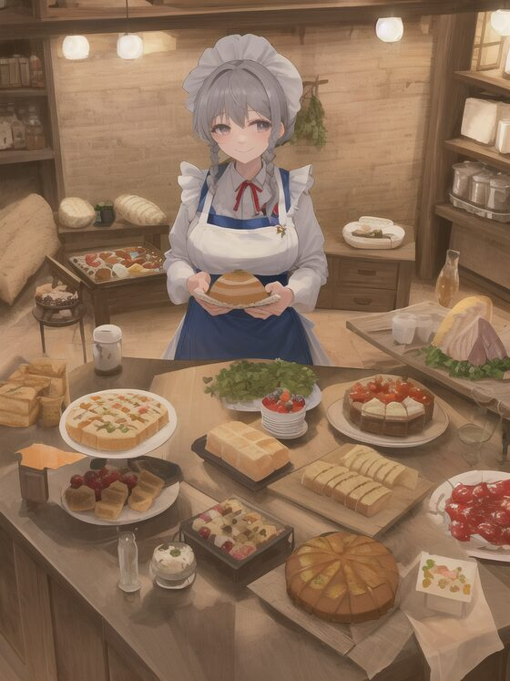

# ester-recipes

<p align="center">
  
</p>

An app that turns a pile of **scanned cooking-recipe clippings** (Italian and Brazilian
Portuguese, often several recipes per image, frequently rotated) into a single, illustrated
**PDF cookbook** — *"Receitas da Ester"* — fully in Brazilian Portuguese, using only **local
models** (Ollama + ComfyUI).

The book has two recipes per page, a small anime image per dish, a clickable index and a
summary of recipes by category.

> 🇧🇷 Versão em português: **[README.pt-BR.md](README.pt-BR.md)**
>
> 🛠️ Building, configuring or changing the app: **[DEVELOPMENT.md](DEVELOPMENT.md)**

## How it works

1. **Reading:** a local vision model transcribes each scan in its original language. Each
   recipe becomes one JSON file, and the scan moves to `recipes/processed/`.
2. **Checking:** a second model reads each scan again, and a report lists the pages where the
   two readings disagree. It changes no recipe.
3. **Translation:** recipes that aren't in Portuguese are translated to Brazilian Portuguese.
4. **Images (optional):** ComfyUI draws one small anime image per recipe, plus the cover.
5. **Book:** the PDF is built from all the recipes stored so far.

## Requirements

- **Java 21+** and **Maven 3.9+** (Maven builds the app the first time you run it)
- **Ollama** at `http://localhost:11434`, with the models pulled:
  ```bash
  ollama pull qwen2.5vl:7b   # reads the scans
  ollama pull gemma4         # checks the readings and translates
  ```
- **Docker** + the **NVIDIA Container Toolkit**, only for the optional images

## Run

Put your scans in `recipes/pending/`, close anything else using the GPU, then:

```bash
./run-all.sh
```

It first checks Java, Ollama, both models, your scans, the free GPU memory and, if you asked for
images, ComfyUI, and doesn't start if something needed is missing. To only run those checks, use
`./run-all.sh --check`.

Allow about 2 minutes per scan for reading and 30 seconds for checking; a page that gets the model stuck can take up to 40 minutes more. For a long batch, use
this so closing the terminal doesn't stop it, and keep the computer from going to sleep:

```bash
./run-all.sh --check && nohup ./run-all.sh > run-all.log 2>&1 &
tail -f run-all.log           # watch the progress
```

If the run stops, run the same command again: scans already read are skipped. A scan that keeps
failing stops the run before the PDF, with an error naming it. Move that scan out of
`recipes/pending/` and run again. A page where the model finds no recipe, such as a notebook cover,
doesn't stop the run: it moves to `recipes/no-recipe/`, and the report lists it for you to look over.

Then open `output/check-report-*.md` to see which pages need review. Two models can misread a word
the same way, so a page that looks fine isn't proof of a correct one.

## Files and folders

```
recipes/
├── pending/      your scans waiting to be read
├── processed/    scans already read
├── no-recipe/    scans where no recipe was found, such as covers
├── json/         one JSON file per recipe
├── images/       one anime image per recipe, plus the cover
└── check/        second readings of the scans, by model
output/           the PDF books, check reports and app logs
runs/             a record of each ./run-all.sh run
comfyui/models/   ComfyUI models (only for the images)
```

The app creates these folders when it needs them. Your scans and everything generated stay on your
machine and out of git.

### Images

| Path | Contents |
|------|----------|
| `recipes/pending/*.jpg` | **You put your scans here.** Only `.jpg`, `.jpeg` and `.png` directly in this folder are read. |
| `recipes/processed/` | Scans moved here once read; a file is never changed. A different scan with a name already used becomes `name-2.jpg`. |
| `recipes/no-recipe/` | Scans where the model found no recipe in any of its attempts. If one has a recipe, move it back to `recipes/pending/`. |
| `recipes/images/<recipe>.png` | The anime image of a recipe, with the same name as its JSON file. Recipes that already have an image are skipped. |
| `recipes/images/_cover.png` | The book cover. |

### Recipes

| Path | Contents |
|------|----------|
| `recipes/json/<category>-<title>.json` | One recipe, such as `paes-pizza.json`: title, category, original language, yield, date, ingredients, steps, source scan, and the `original` and `translated` text. A repeated name becomes `paes-pizza-2.json`. |
| `recipes/check/<model>/<scan>.txt` | The second reading of a scan, such as `gemma4-latest/page.jpg.txt`, so that scan isn't read again by that model. |

### Book, reports and logs

| Path | Contents |
|------|----------|
| `output/receitas-da-ester-YYYY-MM-DD-HH_MI.pdf` | The book. Each run adds a new one. |
| `output/check-report-YYYY-MM-DD-HH_MI.md` | The pages to review, with both readings side by side, scans with no recipe found, and recipes merged or numbered because their names repeat. |
| `output/process-YYYY-MM-DD_HH_MM_SS.log` | The full log of a run. |
| `runs/<timestamp>/process.log` | The same log, kept with the run's record. |
| `runs/<timestamp>/run-info.txt` | Models, code version, scan counts, duration, exit code and main results. |
| `runs/<timestamp>/check-report.md` | A copy of that run's report, if it got that far. |

### Starting over

Back up `recipes/json/` if you may want those recipes. Then move the scans from
`recipes/processed/` and `recipes/no-recipe/` back to `recipes/pending/` and delete `recipes/json/`. Delete `recipes/check/`
too if you want the scans checked again.

Don't delete `recipes/json/` alone: scans in `recipes/processed/` aren't read again, so those recipes
would be lost from the book.

### Comparing runs

```bash
diff runs/<first>/run-info.txt runs/<second>/run-info.txt
```

To try other models, start over as above and run `MAIN_MODEL=other-model ./run-all.sh`.
`CHECK_MODEL` works the same way.

### Repeated recipe names

The book never repeats a name, and the JSON files stay as they are. Two recipes with the same name
and similar contents, such as a clipping scanned twice, count as one, and the most complete reading
goes in the book. If the contents differ, both go in, the second as `Name (2)`.

## Images and cover (optional)

ComfyUI and Ollama don't fit together on an 8 GB GPU, so do this after the scans are read. One time
only, install the toolkit, put a free anime checkpoint in `comfyui/models/checkpoints/` and start
the container:

```bash
sudo apt-get install -y nvidia-container-toolkit
sudo nvidia-ctk runtime configure --runtime=docker && sudo systemctl restart docker
docker compose up -d        # ComfyUI on http://localhost:8188
```

If your checkpoint has another name, add `--ester.images.checkpoint=<file name>` to this command,
which draws the images and builds the book again:

```bash
./run-all.sh --ester.images.enabled=true
```

To redraw a picture you don't like, such as one with a person in it, delete its file in
`recipes/images/` (`_cover.png` for the cover) and run again with a new seed. Only the deleted
pictures are drawn, and the same seed always gives the same picture, so use 2, 3 and so on next time:

```bash
./run-all.sh --ester.images.enabled=true --ester.images.seed-offset=1
```

## Known limitations

- **Handwriting is read poorly**, with wrong words and sometimes wrong or missing quantities. Printed
  and typed pages read much better. Review what the check report flags.
- **Some pages make the model repeat itself** until its answer is cut off, usually in the ingredient
  list. Retries discourage the repetition more each time, but a scan can still stay pending. Those
  retries can change words, so check that page in the report.
- **Translation** may leave a few Italian dish names behind.
- **Reading quality** depends on the scan; the clippings are old and often rotated. Spot-check
  important recipes.
