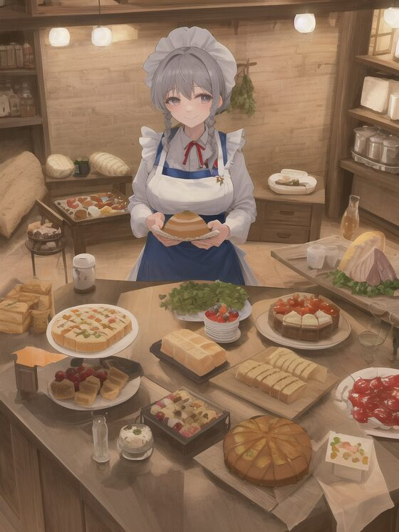

# ester-recipes

<p align="center">
  
</p>

Um aplicativo que transforma uma pilha de **recortes de receitas escaneados** (em italiano e
português do Brasil, muitas vezes com várias receitas por imagem e frequentemente girados) em
um único **livro de receitas em PDF** — *"Receitas da Ester"* — totalmente em português do
Brasil, usando apenas **modelos locais** (Ollama + ComfyUI).

O livro tem duas receitas por página, uma pequena imagem estilo anime por prato, um índice
clicável e um resumo das receitas por categoria.

> 🇬🇧 English version: **[README.md](README.md)**
>
> 🛠️ Para compilar, configurar ou alterar o aplicativo: **[DEVELOPMENT.md](DEVELOPMENT.md)** (em inglês)

## Como funciona

1. **Leitura:** um modelo de visão local transcreve cada escaneamento no idioma original. Cada
   receita vira um arquivo JSON, e o escaneamento vai para `recipes/processed/`.
2. **Conferência:** um segundo modelo lê cada escaneamento de novo, e um relatório lista as
   páginas em que as duas leituras discordam. Nenhuma receita é alterada.
3. **Tradução:** as receitas que não estão em português são traduzidas para o português do Brasil.
4. **Imagens (opcional):** o ComfyUI desenha uma pequena imagem anime por receita, além da capa.
5. **Livro:** o PDF é gerado com todas as receitas guardadas até o momento.

## Pré-requisitos

- **Java 21+** e **Maven 3.9+** (o Maven compila o aplicativo na primeira execução)
- **Ollama** em `http://localhost:11434`, com os modelos baixados:
  ```bash
  ollama pull qwen2.5vl:7b   # lê os escaneamentos
  ollama pull gemma4         # confere as leituras e traduz
  ```
- **Docker** + o **NVIDIA Container Toolkit**, apenas para as imagens opcionais

## Executar

Coloque seus escaneamentos em `recipes/pending/`, feche o que mais estiver usando a GPU e execute:

```bash
./run-all.sh
```

Primeiro, ele verifica o Java, o Ollama, os dois modelos, seus escaneamentos, a memória livre da GPU
e, se você pediu imagens, o ComfyUI, e não começa se faltar algo necessário. Para fazer só essa
verificação, use `./run-all.sh --check`.

Conte cerca de 2 minutos por escaneamento para a leitura e 30 segundos para a conferência; uma página em que o modelo trava pode levar até 40 minutos a mais. Em um lote
longo, use o comando abaixo para que fechar o terminal não interrompa a execução, e não deixe o
computador entrar em suspensão:

```bash
./run-all.sh --check && nohup ./run-all.sh > run-all.log 2>&1 &
tail -f run-all.log           # acompanha o progresso
```

Se a execução parar, rode o mesmo comando de novo: os escaneamentos já lidos são pulados. Um
escaneamento que falha sempre interrompe a execução antes do PDF, com um erro que indica o nome dele.
Retire esse escaneamento de `recipes/pending/` e execute de novo. Uma página em que o modelo não
encontra receita, como a capa de um caderno, não interrompe a execução: ela vai para
`recipes/no-recipe/`, e o relatório a lista para você conferir.

Depois, abra `output/check-report-*.md` para ver quais páginas precisam de revisão. Dois modelos podem
errar a mesma palavra do mesmo jeito, então uma página sem alerta não é prova de que esteja correta.

## Arquivos e pastas

```
recipes/
├── pending/      seus escaneamentos à espera de leitura
├── processed/    escaneamentos já lidos
├── no-recipe/    escaneamentos sem receita encontrada, como capas
├── json/         um arquivo JSON por receita
├── images/       uma imagem anime por receita, além da capa
└── check/        segundas leituras dos escaneamentos, por modelo
output/           os livros em PDF, relatórios de conferência e logs do aplicativo
runs/             um registro de cada execução do ./run-all.sh
comfyui/models/   modelos do ComfyUI (apenas para as imagens)
```

O aplicativo cria essas pastas quando precisa delas. Seus escaneamentos e tudo o que é gerado ficam na
sua máquina e fora do git.

### Imagens

| Caminho | Conteúdo |
|---------|----------|
| `recipes/pending/*.jpg` | **Coloque seus escaneamentos aqui.** Só são lidos arquivos `.jpg`, `.jpeg` e `.png` diretamente nesta pasta. |
| `recipes/processed/` | Escaneamentos movidos para cá depois de lidos; nenhum arquivo é alterado. Um escaneamento diferente com um nome já usado vira `nome-2.jpg`. |
| `recipes/no-recipe/` | Escaneamentos em que o modelo não encontrou receita em nenhuma tentativa. Se algum tiver receita, mova-o de volta para `recipes/pending/`. |
| `recipes/images/<receita>.png` | A imagem anime de uma receita, com o mesmo nome do seu arquivo JSON. Receitas que já têm imagem são puladas. |
| `recipes/images/_cover.png` | A capa do livro. |

### Receitas

| Caminho | Conteúdo |
|---------|----------|
| `recipes/json/<categoria>-<titulo>.json` | Uma receita, como `paes-pizza.json`: título, categoria, idioma original, rendimento, data, ingredientes, modo de preparo, escaneamento de origem e os textos `original` e `translated`. Um nome repetido vira `paes-pizza-2.json`. |
| `recipes/check/<modelo>/<escaneamento>.txt` | A segunda leitura de um escaneamento, como `gemma4-latest/pagina.jpg.txt`, para que esse modelo não o leia de novo. |

### Livro, relatórios e logs

| Caminho | Conteúdo |
|---------|----------|
| `output/receitas-da-ester-AAAA-MM-DD-HH_MI.pdf` | O livro. Cada execução gera um novo. |
| `output/check-report-AAAA-MM-DD-HH_MI.md` | As páginas a revisar, com as duas leituras lado a lado, os escaneamentos sem receita encontrada e as receitas unidas ou numeradas por terem nomes repetidos. |
| `output/process-AAAA-MM-DD_HH_MM_SS.log` | O log completo de uma execução. |
| `runs/<data-hora>/process.log` | O mesmo log, guardado com o registro da execução. |
| `runs/<data-hora>/run-info.txt` | Modelos, versão do código, contagem de escaneamentos, duração, código de saída e principais resultados. |
| `runs/<data-hora>/check-report.md` | Uma cópia do relatório daquela execução, se ela chegou até lá. |

### Recomeçar do zero

Faça uma cópia de `recipes/json/` se quiser guardar essas receitas. Depois, mova os escaneamentos de
`recipes/processed/` e `recipes/no-recipe/` de volta para `recipes/pending/` e apague `recipes/json/`. Apague também
`recipes/check/` se quiser conferir os escaneamentos de novo.

Não apague só `recipes/json/`: os escaneamentos em `recipes/processed/` não são lidos de novo, então
essas receitas sumiriam do livro.

### Comparar execuções

```bash
diff runs/<primeira>/run-info.txt runs/<segunda>/run-info.txt
```

Para testar outros modelos, recomece do zero como acima e execute `MAIN_MODEL=outro-modelo ./run-all.sh`.
O `CHECK_MODEL` funciona do mesmo jeito.

### Nomes de receita repetidos

O livro nunca repete um nome, e os arquivos JSON ficam como estão. Duas receitas com o mesmo nome e
conteúdo parecido, como um recorte escaneado duas vezes, contam como uma, e a leitura mais completa
entra no livro. Se o conteúdo for diferente, as duas entram, a segunda como `Nome (2)`.

## Imagens e capa (opcional)

O ComfyUI e o Ollama não cabem juntos em uma GPU de 8 GB, então faça isto depois de ler os
escaneamentos. Uma única vez, instale o toolkit, coloque um checkpoint anime gratuito em
`comfyui/models/checkpoints/` e suba o contêiner:

```bash
sudo apt-get install -y nvidia-container-toolkit
sudo nvidia-ctk runtime configure --runtime=docker && sudo systemctl restart docker
docker compose up -d        # ComfyUI em http://localhost:8188
```

Se o seu checkpoint tiver outro nome, adicione `--ester.images.checkpoint=<nome do arquivo>` a este
comando, que desenha as imagens e gera o livro de novo:

```bash
./run-all.sh --ester.images.enabled=true
```

## Limitações conhecidas

- **Letra à mão é mal lida**, com palavras erradas e às vezes quantidades erradas ou ausentes. Páginas
  impressas e datilografadas são lidas muito melhor. Revise o que o relatório de conferência apontar.
- **Algumas páginas fazem o modelo se repetir** até a resposta ser cortada, em geral na lista de
  ingredientes. Cada nova tentativa desestimula mais a repetição, mas o escaneamento ainda pode continuar
  pendente. Essas tentativas podem mudar palavras, então confira essa página no relatório.
- **A tradução** pode deixar passar alguns nomes de pratos em italiano.
- **A qualidade da leitura** depende do escaneamento; os recortes são antigos e muitas vezes girados.
  Confira as receitas importantes.
